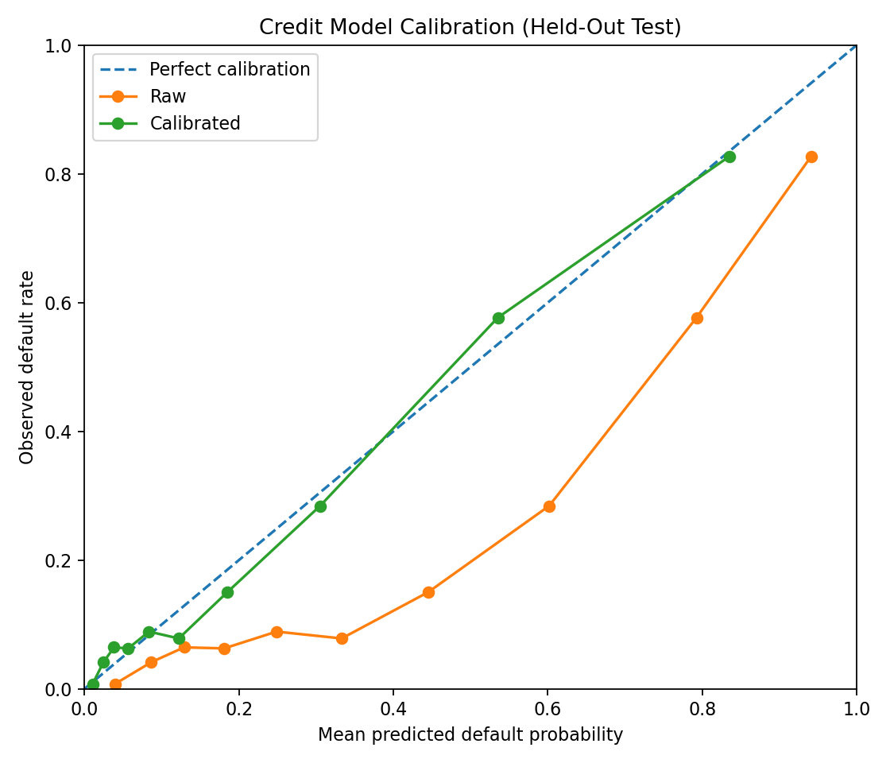

# Credit Risk Model Validation & Fraud Monitoring Dashboard

[](https://www.python.org/)
[](https://creditriskmodel-validation-dashboard-8ywl4lthbwtaabwvvzrxso.streamlit.app/)
[](https://scikit-learn.org/)

**An end-to-end machine learning and interactive risk analytics project** covering credit default prediction, probability calibration, fraud detection experiments, model evaluation, and portfolio monitoring.

### [🚀 Open the Live Streamlit Dashboard](https://creditriskmodel-validation-dashboard-8ywl4lthbwtaabwvvzrxso.streamlit.app/)

**[📁 View the GitHub Repository](https://github.com/chandanaseelam/Credit_Risk_Model-Validation-Dashboard)**

The dashboard is deployed on Streamlit Community Cloud and can be opened directly in a browser. No local setup is required to explore the live application.

> **Educational and portfolio project.** Results illustrate a model-development and validation workflow, **not** production-ready credit decisions, fraud prevention, or regulatory certification. The fraud models perform poorly on unseen data; their weaknesses are reported transparently.

---

## 1. Project Overview

A financial institution needs to understand two different risks:

- **Credit risk:** Which loans have a higher estimated probability of default? How does this risk vary across grades, and what are the implications for estimated expected loss?
- **Fraud risk:** Can transaction features distinguish fraudulent activity from legitimate activity on **future, unseen** transactions?

The project trains and evaluates models for both questions, generates scored data and evaluation reports, and presents the results through a **five-tab Streamlit dashboard**.

### Dashboard sections

| Page | What it shows |
| --- | --- |
| **Executive Overview** | Loan and transaction counts, observed event rates, calibrated PD, estimated expected loss, and held-out model metrics |
| **Credit Risk** | Calibrated risk tiers, PD distribution, default rates by grade, and loss comparisons |
| **Fraud Monitoring** | Alerts, true/false positives, observed fraud rates, and score distributions |
| **Model Validation** | Credit calibration comparison, reliability plot, confusion matrices, and fraud model benchmarks |
| **Data Explorer** | Filterable credit and fraud datasets with CSV export |

### Workflow

```text
Credit loan records ──> Cleaning & encoding ──> Logistic Regression
                                                   │
                                   Validation-set sigmoid calibration
                                                   │
                           Credit scores, loss estimates, test metrics
                                                   │
                                                   ├──> Streamlit Dashboard
                                                   │
Transaction records ──> Time features & encoding ─> Random Forest / Logistic Baseline
                                                   │
                                    Chronological train/val/test
                                                   │
                                Fraud scores and held-out test metrics
```

---

## 2. Technology Stack

- **Language:** Python 3.11
- **Data analysis:** Pandas, NumPy
- **Machine learning:** scikit-learn (Logistic Regression, Random Forest, preprocessing pipelines)
- **Model persistence:** Joblib
- **Visualization:** Matplotlib, Streamlit
- **Development:** VS Code, Terminal, Git and GitHub
- **Platform:** Developed and tested on macOS; deployed using Streamlit Community Cloud
- **Original visualization artifact:** Power BI `.pbix` file (Power BI Desktop itself does not run natively on macOS)

---

## 3. Datasets

| Dataset | Records | Target | Positive class |
| --- | ---: | --- | --- |
| `credit_risk_dataset.csv` | 32,581 loans | `loan_status` | `1` = default |
| `credit_card_fraud_dataset.csv` | 100,000 transactions | `IsFraud` | `1` = fraud |

The credit dataset contains borrower and loan attributes, including income, home ownership, loan amount, interest rate and loan grade. The fraud dataset contains transaction time, amount, merchant identifier, transaction type and location.

**Fraud class distribution:** 99,000 normal transactions (99%) and 1,000 fraudulent transactions (1%). Because the target is rare, accuracy alone can be misleading; this project emphasizes **ROC-AUC, average precision, precision, recall and confusion matrices**.

> Dataset publication note: Only publish datasets you are authorized to share. The scored datasets provided for the live demo contain project data and model outputs; verify that they contain no confidential or personally identifying information before updating them.

---

## 4. Credit Risk Modeling and Calibration

### Approach

1. Prepare numeric and categorical predictors using scikit-learn transformers for missing values, standardization and one-hot encoding.
2. Train a **class-weighted Logistic Regression** model on a stratified training split.
3. Partition the dataset into **60% training, 20% calibration/validation and 20% testing**.
4. Fit a separate **sigmoid (Platt-style) calibrator** to validation predictions, without fitting the calibrator on test labels.
5. Compare raw and calibrated predictions on the held-out credit test split.
6. Produce calibrated **Probability of Default (PD)** scores and illustrative loan risk tiers.

### Credit test-set results

| Metric | Raw model | After calibration |
| --- | ---: | ---: |
| **ROC-AUC** | 0.8711 | **0.8711** |
| **Average precision** | 0.7230 | **0.7230** |
| **Brier score ↓** | 0.1381 | **0.1024** |
| **Log loss ↓** | 0.4359 | **0.3393** |
| **Mean estimated PD** | 37.98% | **21.96%** |
| Observed test default rate | 21.82% | 21.82% |

**Key finding:** Sigmoid calibration decreased the Brier score by approximately **25.9%** on this test split while preserving ranking performance (ROC-AUC). The calibrated mean score is close to the observed default rate, and the reliability plot provides a more detailed probability-vs-outcome check.



**Important:** A single test split does not establish performance across future populations. This test data was inspected during development, so a genuinely new, untouched dataset would be needed for an unbiased final validation.

### Risk tiers and expected loss

Calibrated loan scores are assigned illustrative categories:

| Risk tier | Calibrated PD |
| --- | --- |
| Low | 0%–5% |
| Medium | Above 5% to 15% |
| High | Above 15% |

These are **project-defined thresholds**, not official banking risk categories.

The dashboard estimates expected loss using:

```text
Expected Loss (EL) = PD × LGD × EAD

PD  = calibrated model-estimated Probability of Default
LGD = assumed Loss Given Default (45%)
EAD = illustrative Exposure at Default, using loan amount
```

This is a simplified educational estimate. No currency is asserted, and neither the assumed LGD nor the displayed default-based loss proxy represents documented realized bank losses.

---

## 5. Fraud Detection and Model Validation

### Approach

The fraud experiments use a **chronological 60% training / 20% validation / 20% test split** to approximate scoring later transactions from earlier data.

- Exclude the unique `TransactionID` from predictive features.
- Convert `MerchantID` to a categorical feature rather than treating identifier values as continuous quantities.
- Derive hour, day-of-week, day and month features from `TransactionDate`.
- Compare Random Forest V2 with a Logistic Regression baseline.
- Select an approximately **1% alert-rate threshold using validation predictions only** and apply the fixed threshold to the test period.

### Chronological held-out fraud results

| Metric | Random Forest V2 | Logistic Regression baseline |
| --- | ---: | ---: |
| **ROC-AUC** | 0.4586 | 0.4752 |
| **Average precision** | 0.0091 | 0.0098 |
| **Fraud cases in test period** | 203 | 203 |
| **Frauds correctly detected** | 1 | 1 |
| **Frauds missed** | 202 | 202 |
| **False alerts** | 102 | 179 |
| **Actual test alert rate** | 0.52% | 0.90% |

**Key finding:** Neither model demonstrates reliable discrimination on the chronological test period. At a roughly 1% fraud base rate, their average precision scores are close to the base-rate benchmark.

### Generalization investigation

| Model | Training ROC-AUC | Validation ROC-AUC | Test ROC-AUC |
| --- | ---: | ---: | ---: |
| Random Forest V2 | 1.0000 | 0.4801 | 0.4586 |
| Logistic Regression | 0.8299 | 0.5148 | 0.4752 |

The severe drop from training to validation/test indicates **overfitting or non-generalizing patterns**, especially in the Random Forest. Removing `MerchantID` sharply reduced Logistic Regression training performance but did not establish a useful validation model. Merchant-level fraud-rate correlation across training and validation was approximately **0.046**, though these merchant rates are noisy because fraud is rare.

The original Random Forest V1 is retained for historical comparison, but its alert threshold was derived from test predictions and its random split differs from the chronological V2 evaluation. **V1 and V2 scores should not be treated as a controlled like-for-like performance comparison.**

> **Model-governance decision:** The fraud models are **not suitable for production use**. The dashboard explicitly exposes their weak recall and ranking performance rather than presenting the high majority-class accuracy as success.

---

## 6. Project Structure

```text
Credit_Risk_Model-Validation-Dashboard/
├── README.md
├── requirements.txt
├── .gitignore
├── streamlit_app.py                   # Live Streamlit dashboard
├── credit_model.py                    # Original credit model
├── credit_model_v2.py                 # Credit model + sigmoid calibration
├── fraud_model.py                     # Original fraud model
├── fraud_model_v2.py                  # Chronological Random Forest experiment
├── fraud_logistic_baseline.py         # Chronological Logistic Regression baseline
├── make_visualizations.py            # Original chart generation
├── credit_risk_dataset.csv           # Source credit records
├── credit_card_fraud_dataset.csv     # Source fraud records
├── credit_scored_v2.csv               # Committed for the live Streamlit demo
├── fraud_test_scored_v2.csv           # Committed for the live Streamlit demo
├── credit_metrics_v2.json
├── fraud_metrics_v2.json
├── fraud_logistic_metrics.json
├── credit_calibration_bins_v2.csv
├── credit_calibration_plot_v2.png
├── images/                             # Existing project images
├── visualizations/                     # Original generated figures
└── Risk & Credit.pbix                 # Original Power BI report
```

The training scripts also create `*.pkl` model artifacts and other scored CSVs. Those are generally excluded by `.gitignore`. Two scored CSV files were intentionally added for the deployed dashboard, which reads precomputed model results rather than training models on each app visit.

---

## 7. Run the Project Locally

### Requirements

- Python 3.11 recommended
- Git
- Python dependencies listed in `requirements.txt`

### Clone and install

```bash
git clone https://github.com/chandanaseelam/Credit_Risk_Model-Validation-Dashboard.git
cd Credit_Risk_Model-Validation-Dashboard

python3 -m venv .venv
source .venv/bin/activate
python -m pip install -r requirements.txt
```

On macOS with an existing Anaconda installation, the project was also executed successfully using `/opt/anaconda3/bin/python`. Use one interpreter consistently rather than mixing environments.

### Reproduce model outputs

```bash
python credit_model_v2.py
python fraud_model_v2.py
python fraud_logistic_baseline.py
```

These scripts generate V2 scored datasets, test predictions, saved pipelines, metrics JSON and the credit calibration chart. Training may take time, especially for the fraud Random Forest.

### Launch the dashboard

```bash
python -m streamlit run streamlit_app.py
```

Open the URL Streamlit prints in Terminal (normally `http://localhost:8501`). Press **Control+C** in the Terminal to stop the application.

**Quick dashboard-only start:** The repository already includes the two main scored CSVs needed for the deployed dashboard and the published metrics, so you can launch Streamlit directly after installing dependencies without retraining models.

### Deploy on Streamlit Community Cloud

1. Sign in at [Streamlit Community Cloud](https://share.streamlit.io/) with GitHub.
2. Select the `chandanaseelam/Credit_Risk_Model-Validation-Dashboard` repository.
3. Choose branch `main`, entry point `streamlit_app.py` and the Python dependencies in `requirements.txt`.
4. Deploy the app. The already deployed version is linked at the top of this README.

---

## 8. What the Dashboard Metrics Mean

- **Observed default/fraud rate:** Proportion of records labeled positive in the selected data.
- **Mean PD:** Average *calibrated credit* prediction, reported separately from the observed default rate.
- **ROC-AUC:** Ranking quality across classification thresholds; it is **not** classification accuracy.
- **Average precision:** A precision–recall summary particularly helpful for rare outcomes.
- **Brier score / log loss:** Probability quality measures; lower is better.
- **Fraud alert rate:** Fraction of transactions flagged at the validation-selected threshold.
- **Expected loss:** A modeled amount using assumed exposure and loss severity, **not actual realized losses**.

**Full scored datasets include some training records.** Portfolio distributions are descriptive; rely on the documented held-out results for model assessment and use new unseen data for final independent testing.

---

## 9. Current Limitations and Next Improvements

**Current limitations**

- Fraud features did not yield reliable held-out discrimination; both tested fraud models are unsuitable for operational use.
- The fraud scores have not been demonstrated to be calibrated probabilities.
- The calibrated credit model improved Brier score on the examined split, but independent prospective or external validation is still needed.
- Expected loss uses an assumed 45% LGD and loan amount as a simple exposure proxy.
- This is a portfolio demonstration, not a bank-grade decisioning, compliance or monitoring platform.

**Planned improvements**

- Add external or out-of-time credit validation and score drift monitoring.
- Improve uncertainty reporting and probability calibration diagnostics.
- Test fraud detection using a more informative dataset and an untouched future evaluation period.
- Add automated data-quality checks, model tests and clearer sample-size annotations to risk charts.
- Add polished screenshots to the existing `images/` folder and link them here after confirming their filenames.

---

## 10. Project Ownership and Use

Maintained in [@chandanaseelam](https://github.com/chandanaseelam)'s GitHub repository. The original Power BI and Python implementation and the additional macOS-compatible model validation and Streamlit development are documented together in the repository history.

Unless a separate license is supplied, public repository visibility alone does **not** grant third parties unrestricted reuse rights. Dataset provenance and permission should be reviewed before republishing or operational use.

**For educational and portfolio demonstration only.**
